# Postwerk

**Early development: not ready for production yet.**

Postwerk is a small, self-hosted SMTP relay for outgoing transactional email, written in Go. Applications in Docker or
Kubernetes send their mail through it instead of straight to a provider. Postwerk keeps an audit log of every mail and
tracks its delivery to each target. It runs as one binary with one SQLite file.

To try it on your machine with Docker Compose and Mailpit, see [Getting started](docs/getting-started.md).

## Why put a relay in front of your email provider

- **One place for all outgoing mail.** Every application sends through the same relay, each with its own login.
- **Every mail is traceable.** Each mail gets an id (`pw_…`) and one tracked delivery per target. Every attempt, retry
  and result is an event.
- **No mail lost when the provider is down or credentials rotate.** Mails wait in the queue and are retried.
- **Small.** No database server. It runs as non-root on a read-only file system.

**Testing:** add [Mailpit](https://mailpit.axllent.org) as a target. Every mail lands there, so you can look at each
one, and tests can read them through Mailpit's API.

**Production:** leave Mailpit out. It keeps every mail in full, including password reset links, which is a privacy
problem. Rely on Postwerk's audit log instead: it records what happened to each mail without keeping its content.
Errors, such as a rejected provider login, are reported as events (JSON on stdout today; OpenTelemetry, Sentry protocol
and webhooks are planned).

## How the SMTP relay works

An application hands a finished mail to Postwerk over SMTP. Postwerk stores it encrypted, then replies `250`. It
delivers one copy to each configured target (a provider such as Mailjet, a capture tool such as Mailpit, or any SMTP
server) and retries temporary failures. Every step goes into an append-only event log. The raw message is removed once
every target has it.

## Postwerk compared with Postfix and maddy

| | Postwerk | Postfix | maddy |
|---|---|---|---|
| What it is | outbound relay with audit log | full mail transfer agent | all-in-one mail server |
| Receives mail for mailboxes | no | yes | yes |
| Several destinations per mail | list of targets, each tracked | extra recipients, not tracked separately | several `deliver_to` per block |
| Per-mail audit | event log; query API and UI planned | log files, `postqueue` | logs |
| Maturity | early development | decades of production use | younger project |

Use Postfix or maddy if you need to receive mail, host mailboxes or sign DKIM yourself. Full comparison and other
options: [docs/scope.md](docs/scope.md).

## Documentation

- [Getting started](docs/getting-started.md): local example, test mail, senders, keys, minimal configuration
- [FAQ](docs/faq.md): short answers to common questions
- [Configuration](docs/configuration.md): every environment variable, secret files and key files
- [Design](docs/design.md): components, targets, mail lifecycle, retry policy, event model
- [Code architecture](docs/architecture.md): packages, data flow, store schema, delivery worker
- [Scope and fit](docs/scope.md): what Postwerk does and does not do, comparison, integration checklist
- [Privacy and security](docs/privacy-and-security.md): what is stored, for how long, who can read it
- [Requirements](docs/requirements.md): numbered requirements, built and later
- [Decisions](docs/decisions.md): design decisions and their reasons

## License

MIT, provided as is, without warranty of any kind. See [LICENSE](LICENSE).
